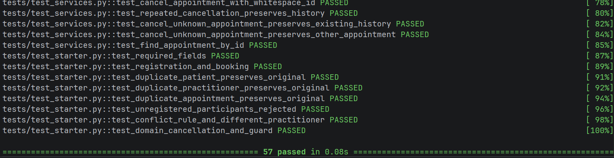

# Stage 7 Testing and Verification Record

Group/tutorial: Group 2, Monday Tutorial 2:30-4:30  Members/cohorts: Cassandra Navarro | Reema Majed M
Requirements baseline: SmartCare A3 Requirements Baseline 2026, revision 2.
Use the same project/. Link actual evidence; keep responses concise. Blank fields are for your group. Copy rows only as needed.

All Assignment 3 stage materials are provided from the beginning. Complete this stage only after the previous applicable stage has been integrated, verified and recorded. Use this supplied record in stage07/ in your EXISTING repository. Preserve project/, all earlier tests, records and responses. Do not download another starter or copy staff solutions.

## A Tutorial Activities

### Activity 1 Requirement to test

For each requirement, propose one positive test, one negative test and the key assertion.

| Requirement | Positive test                                                      | Negative test                                                                                         | Key assertion                                                   |
|---|--------------------------------------------------------------------|-------------------------------------------------------------------------------------------------------|-----------------------------------------------------------------|
| FR-01 Register patient | Patient is succesfull stored in data base                          | Attempting to register another patient using an existing patient ID                                   | Duplicate registration can raise ValueError                     |
| FR-05 Prevent practitioner conflict | Booking appointments with different practitioners at the same time | Booking the same appointment at the exact same time when an existing appontment is arlready scheduled | Conflict bookings can raise ValueError                          |
| FR-06 Cancel appointment | Cancel an appointment with a SCHEDULED status                      | Already CANCELLED appointment attempting to cancel                                                    | Repeated cancellation raises ValueError                         |
| FR-07 Retain cancelled history | Cancel an appointment but can stil retrieve it using the ID        | Attempting to search for an appointment using an unknown ID                                           | Cancelled appointment remains retrievavle with Cancelled status |

### Activity 2 Strong or weak assertion

For each, select Strong for stated behaviour or Weak/unclear and explain why. State the behaviour and limits.

`assert True`
Judgement: Weak/unclear  Why: The asserstion always passes regardless the behaviour. It technically does not verify any requirement or check if whether the expected result got achieved 

`assert appointment is not None`
Judgement: Weak/unclear  Why: Only shows that the appointment exists. It does not verify if the appointment is correct. 
`assert appointment.status == AppointmentStatus.CANCELLED`
Judgement: [Strong for stated behaviour / Weak/unclear]  Why: [response]

`assert len(results) > 0`
Judgement: Weak/unclear  Why: Only confirms that the result list at least one item. Does not show if the correct appointment is included, and if the results meet the requirement. 

`assert data_store.find_appointment('A1') is appointment`
Judgement: Strong for stated behaviour  Why: It checks that the data store returns to the appointment object, it shows that the expected appointment is retained in the store. It does now show if the status or the other details are correct but it still verifies the data store. 

### Activity 3 Boundary thinking

Design boundary or edge cases for blank identifiers, whitespace-only names, same-time practitioner bookings, cancelled appointments and invalid status transitions.
For each input/state, expected result and supporting contract:

1. Blank Identifiers
   - Input/State: A patient is registered using an empty patient ID 
   - Expected Result: the system shall reject the search and raise a ValueError, showing that it cannot return the search 
   - Supporting Contract: patient ID must be trimmed and non-blank. An empty identifier is invalid 
2. Whitespace-only names 
   - Input/State: A patient is registered with a name containing only spaces
   - Expected Result: The system should reject the registration and raise a ValueError because it does not contain any text 
   - Supporting Contract: Required name fields must not be blank or contain any whitespace
3. Same-time practitioner Bookings 
   - Input/state: if two appointments are created for the same practitioner at the exact same date and time, with the first appointment and still having a SCHEDULED status 
   - Expected Result: The system should reject the second booking and raise a ValueError, this is because the practitioner already has a scheduled appointment at that time 
   - Supporting Contact: FR-O5 prevents appointment from being booked from the same practitioner at the same time when an appointment is already booked 
4. Cancelled Appointments 
   - Input/State: An appointment has already been cancelled and has a CANCELLED status 
   - Expected Result: the system should reject the other cancellation if the booking is already cancelled and should raise a ValueError 
   - Support Contract: FR-06 allows cancellation of scheduled appointments, but repeated cancellation is not permitted
5. Invalid Status Transitions 
   - Input/State: If an appointment has already a COMPLETED status, and a user attempts to cancel the booking 
   - Expected Result: The system should raise a ValueError and preserve the appointment's COMPLETED staus 
   - Supporting Contact: The appointment cancellation shows the valid status transitions. A completed appointment cannto be cancelled

### Activity 4 Critique GitHub Copilot tests

GitHub Copilot generates five tests, all of which pass. Two only assert that objects are not None, one asserts True, and two assume SMS notifications exist. Identify what is wrong and rewrite the test intentions.

| Candidate                        | What is wrong                                                                                                                                                                 | Rewritten test intention                                                                                                                                                                |
|----------------------------------|-------------------------------------------------------------------------------------------------------------------------------------------------------------------------------|-----------------------------------------------------------------------------------------------------------------------------------------------------------------------------------------|
| 1. Patient Registration          | The assertion "assert patient is not None" only checks that a patient object is returned. It does not confirm that the patient is correctly registered or stored              | Should verify that a valid patient is registred successfully and can be retrieved from the data and using the correct patient details such as the patient ID and other information      |
| 2. Appointment Booking           | The assertion "assert appointment is not None" only checks that an appointment object exists. It does not verify anything importatn such as the detail, status. or the storage | Verify that the valid appointment is the booked appointment with the correct patient, practitioner and date/time, starts with SCHEDULED status, and can be retrieved from the data store |
| 3. Appointment Cancellation      | The assert "assert true" always passes, and if the cancellation does not work, and it does not check the outcome                                                              | Verify the cancelling a scheduled appointment succesfully changes to its status to CANCELLED                                                                                            |
| 4. Booking SMS notification      | The test assumes that booking sends an SMS notification, but this feature is not specified in the SmartCare requirements or supported by the current system                   | Must verify that a valid appointment is succesfully booked and stored without assuming that an SMS notification is sent                                                                 |
| 5. Cancellation SMS notification | The test assumes that the cancellation sends an SMS notification and uses "sms_notifcation_sent", an attribute that is not exisitng within the system                         | Should verify that the cancelling an appointment changes its sttus to CANCELLED and that the apppointment that is cancelled can be retrieved from the data store                        |

### Tutorial exit question

Why can 100% code coverage coexist with poor software verification?
- A 100% code coverage can coexist with the poor software verification because it only means that every line of code has been executed during the testing, and it does not guarantee that the test check and whether the software can behave correctly or can meet the requirements that is essential. A good software verification requires a meangingful assertion, having positive and negative tests, and boundary cases to confir that the system behaves as it should. 

## B Requirement to Test Traceability Matrix

Assign TEST IDs before implementation or generation. Use canonical AC IDs with their actual meaning; quote supporting revision 2 contracts when no canonical AC is assigned. Blank-ID validation is not AC-01.2. Identify supplied versus student-authored evidence.

| Requirement       | Acceptance criterion                                                                                                 | Test ID | Test type          | Test name / location                                                        | Expected behaviour                                                                                 | Result / observed status | Supplied or student-authored            |
|-------------------|----------------------------------------------------------------------------------------------------------------------|---------|--------------------|-----------------------------------------------------------------------------|----------------------------------------------------------------------------------------------------|--------------------------|-----------------------------------------|
| FR-01             | Revision 2 Validation contract: Patient ID and details such as name must  not be blank or missing                    | D1      | Positive           | test_patient_valid_fields_are_trimmed- test_domain.py                       | A patient is created with the correct ID and name                                                  | NOT YET TESTED           | student-authored                        |
| FR-01             | Revision 2 Validation contract: required patient fields cannot be blank or missing                                   | D2      | Negative/Boundary  | test_patient_rejects_invalid_required_fields- test_domain.py                | Blank, whitespace and "none" patient fields raise ValueError                                       | NOT YET TESTED           | student-authored                        |
| FR-03             | Revision 2 Validation contract: Required practitioner fields should be valid                                         | D1      | Positive           | test_practitioner_valid_fields_are_trimmed- test_domain.py                  | A practitioner is created with the correct ID name and speciality                                  | NOT YET TESTED           | student-authored                        |
| FR-03             | Revision 2 Validation contract: Practitioner details shouild not be blank or missing                                 | D4      | Negative/Boundary  | test_practitioner_rejects_invalid_required_fields- test_domain.py           | Raises ValueError if invalid practitioner fields                                                   | NOT YET TESTED           | student-authored                        |
| FR-04             | AC-03.1-- A valid appointment start with SCHEDULED status and contains registerd participants                        | D5      | Positive           | test_appointment_starts_scheduled_and_keeps_participants- test_domain.py    | the appointment retains the correct ID, participants, date/time and intial SCHEDULED status        | NOT YET TESTED           | student-authored                        |
| FR-04             | Revision 2 domain contract: Appointment participants must and should be valid patient and practitioner               | D6      | Negative           | test_appointment_rejects_invalid_participants_objects- test_domain.py       | Invalid participant object types raise ValueError                                                  | NOT YET TESTED           | student-authored                        |
| FR-04             | Revision 2 validation contract: appointment date/time must be a valid local, and minute                              | D7      | Negative/Boundary  | test_appointment_rejects_invalid_date_time- test_domain.py                  | Strings such as seconds, microseconds, and timezone aware date/times should raise ValueError       | NOT YET TESTED           | student-authored                        |
| FR-04             | Revision 2 validation contract: appointment status should be valid AppointmentStatus value                           | D8      | Negative           | test_appointment_rejects_invalid_status- test_domain.py                     | Invalid status shoiuld raise ValueError                                                            | NOT YET TESTED           | student-authored                        |
| FR-06             | AC-05.1-- Cancelling a SCHEDULED appointment should change status to CANCELLED                                       | D9      | Positive           | test_cancellation_changes_status- test_domain.py                            | Appointment status changes to AppointmentStatus.CANCELLED                                          | NOT YET TESTED           | Supplied intention, extended by student |
| FR-06             | AC-05.3-- Any repeated cancellation is rejected                                                                      | D10     | Negative           | test_repeated_cancellation_is_rejected- test_domain.py                      | A second cacellation should raise ValueError and the status will still remain as CANCELLED         | NOT YET TESTED           | Supplied intention, extended by student |
| Domain Validation | Revision domain 2 contract: Invalid appointment status change are prevented                                          | D11     | Negative           | test_complete_appointment_cannot_be_cancelled- test_domain.py               | Cancelling a COMPLETED appointment raises ValueError and the status still remains as COMPLETED     | NOT YET TESTED           | student-authored                        |
| Domain Validation | Revision 2 contract: patient ID cannot be changed after the creation                                                 | D12     | Negative           | test_patient_id_cannot_be_changed_- test_domain.py                          | changing the patient ID should raise an AttributeError, and the original ID remains unchanged      | NOT YET TESTED           | student-authored                        |
| Domain Validation | Revision 2 contract: practitioner ID cannot be changed after the creation                                            | D13     | Negative           | test_practitioner_id_cannot_be_changed_- test_domain.py                     | changing the practitioner ID should raise an AttributeError, and the original ID remains unchanged | NOT YET TESTED           | student-authored                        |
| Domain Validation | Revision 2 contract: appointment ID cannot be changed after the creation                                             | D14     | Negative           | test_appointment_id_cannot_be_changed_- test_domain.py                      | changing the practitioner ID should raise an AttributeError, and the original ID remains unchanged | NOT YET TESTED           | student-authored                        |
| FR-02             | AC-02.1-- Lookup of a known patient succeeds                                                                         | S1      | Positive           | test_find_patient-test_services.py                                          | the registered patient is looked up correctly                                                      | NOT YET TESTED           | student-authored                        |
| FR-02             | AC-02.2-- Lookup of a known patient reports absence                                                                  | S2      | Negative           | test_find_unknown_patient_test_services.py                                  | the unknown patient is loo up raise LookupError                                                    | NOT YET TESTED           | student-authored                        |
| FR-02             | Revision 2 validation contract: Patient lookup ID cannot be unknown                                                  | S3      | Negative/Boundary  | test_find_patient_with_blank_id-test_services.py                            | Blank patient ID raises the ValueError                                                             | NOT YET TESTED           | student-authored                        |
| FR-03             | Supporting operation: lookup of a registered practitioner succeeds                                                   | S4      | Positive           | test_find_unknown_practitioner-test_services.py                             | Unknown practitioner lookup raises the LookupError                                                 | NOT YET TESTED           | student-authored                        |
| FR-03             | Supporting operation: lookup of an unknown practitioner                                                              | S5      | Negative           | test_find_unknown_practitioner-test_services.py                             | Unknown practitioner lookup raises the LookupError                                                 | NOT YET TESTED           | student-authored                        |
| FR-03             | Revision 2 validation contract: practitoner look up ID cannot be blank                                               | S6      | Negative/ Boundary | test_find_practitioner_with_blank_id-test_services.py                       | Blank practitioner ID raises ValueError                                                            | NOT YET TESTED           | student-authored                        |
| FR-06/ FR-07      | AC-05.1 and AC 05.2-- Cancellation changes status and cancelled history remains retrievable                          | S7      | Positive           | test_cancel_appointment-test_services.py                                    | Appointment become CANCELLED and remains stored and retrievable                                    | NOT YET TESTED           | student-authored                        |
| FR-06             | Revision 2 validation contract: Appointment cancellation ID cannot be blank                                          | S8      | Negative/Boundary  | test_cancel_appointment_with_blank_id-test_services.py                      | Blank appointment ID raises ValueError                                                             | NOT YET TESTED           | student-authored                        |
| FR-06             | AC-05.3-- Repeated cancellation is rejected                                                                          | S9      | Negative           | test_cancel_appointment_twice-test_services.py                              | A second cancellation raises ValueError and the appointment status remains unchanged               | NOT YET TESTED           | student-authored                        |
| FR-03             | Supporting operation: practitioner lookup accepts the surrounding whitespace where the trimming is specified         | S11     | Boundary           | test_find_practitioner_with_spaces-test_services.py                         | Practitioner is found after trimming the whitespace                                                | NOT YET TESTED           | student-authored                        |
| FR-02             | Supporting operation: patient lookup accepts the surrounding whitespace where the trimming is specified              | S12     | Boundary           | test_find_patient_with_spaces-test_services.py                              | Patient is found after trimming the whitespace                                                     | NOT YET TESTED           | student-authored                        |
| FR-03             | Revision 2 contract:  practitioner IDs are case-sensitive                                                            | S13     | Negative/Boundary  | test_find_practitioner_is_case_sensitive-test_services.py                   | An ID with different casing does not match the registered practitioner                             | NOT YET TESTED           | student-authored                        |
| FR-02             | Revision 2 contract:  patient IDs are case-sensitive                                                                 | S14     | Negative/Boundary  | test_find_patient_is_case_sensitive-test_services.py                        | An ID with different casing does not match the registered patient                                  | NOT YET TESTED           | student-authored                        |
| FR-02             | Revision 2 validation contract:  patient lookup IDs must be string                                                   | S15     | Negative           | test_find_patient_with_non_string_id-test_services.py                       | a non-string ID raises ValueError                                                                  | NOT YET TESTED           | student-authored                        |
| FR-03             | Revision 2 validation contract:  practitioner lookup IDs must be string                                              | S16     | Negative           | test_find_practitioner_with_non_string_id-test_services.py                  | a non-string ID raises ValueError                                                                  | NOT YET TESTED           | student-authored                        |
| FR-06             | Revision 2 validation contract:  unknown appointment cancellation is rejected                                        | S17     | Negative           | test_cancel_appointment_with_unknown_id-test_services.py                    | Unknown appointment ID raises lookupError                                                          | NOT YET TESTED           | student-authored                        |
| FR-06             | Revision 2 validation contract:  Appointment cancellation ID must be string                                          | S18     | Negative           | test_cancel_appointment_with_non_string_id-test_services.py                 | non string ID ID raises ValueError                                                                 | NOT YET TESTED           | student-authored                        |
| FR-06             | Revision 2 validation contract: Appointment cancellation ID is trimmed                                               | S19     | Boundary           | test_cancel_appointment_with_whitespace_id-test_services.py                 | Appointment is found and cancelled using an ID with surrounding whitespace                         | NOT YET TESTED           | student-authored                        |
| FR-07             | AC-5.2 and AC-5.3-- Cancelled history remains stored after a repeated cancedllation attempt                          | S20     | Negative           | test_repeated_cancellation_preserves_history-test_service.py                | Repeated cancellation is rejected and the original cancelled appointment remains retrievable       | NOT YET TESTED           | student-authored                        |
| FR-07             | AC-5.2-- Failed cancellation of an unknown appointment does not affect the existing history                          | S21     | Negative           | test_cancel_unknown_appointment_preserves_existing_history-test_service.py  | Unknown appointment cancellation is rejected and existing appointment history remains unchanged    | NOT YET TESTED           | student-authored                        |
| FR-06/ FR-07      | Revision 2 contract: Cancellation of a COMPLETED appointment is rejected without chanhging other appointment records | S22     | Negative           | test_cancel_unknown_appointment_preserves_other_appointment-test_service.py | Completed appointment remains unchanged and other appointment records are preserved                | NOT YET TESTED           | student-authored                        |
| FR-08             | AC-06.1- A known appointment ID returns that appointment                                                             | S23     | Positive           | test_find_appointment_by_id-test_services.py                                | the correct stored appointment is returned when searching using its ID                             | NOT YET TESTED           | student-authored                        |

## C Test Design

Use descriptive test names such as test_cancel_changes_status() or test_blank_patient_id_is_rejected(). Explain what new evidence each case adds.

| Test ID | Requirement       | Acceptance criterion                                                                                   | Positive / Negative / Boundary | Test intention                                                                                | Observable result expected                                                   | Added evidence beyond supplied tests                                                                                         |
|---------|-------------------|--------------------------------------------------------------------------------------------------------|--------------------------------|-----------------------------------------------------------------------------------------------|------------------------------------------------------------------------------|------------------------------------------------------------------------------------------------------------------------------|
| D1      | FR-01             | Revision 2 Validation contract: Patient ID and details such as name must  not be blank or missing      | Positive                       | Verify that a patient can be created with a valid ID and name                                 | patient object contains the correct ID and name                              | Confirms valid patient construction                                                                                          |
| D2      | FR-01             | Revision 2 Validation contract: required patient fields cannot be blank or missing                     | Negative/Boundary              | Verifying that a blank, whitespace-only and missing patient fields are rejected               | ValueError is raised                                                         | exxtends the validation beyond the supplied blank patient ID by checking invalid values                                      |
| D3      | FR-03             | Revision 2 Validation contract: Required practitioner fields should be valid                           | POSITIVE                       | Verify that a practitioner can be created with valid details                                  | practitioner object contains the correct details                             | adds the evidence for valid practitioner construction                                                                        |
| D4      | FR-03             | Revision 2 Validation contract: Practitioner details shouild not be blank or missing                   | Negative/Boundary              | Verify that the invalid practitioner fields are rejected                                      | ValueError is raised                                                         | extends the required-field validation to all practitioner fields                                                             |
| D5      | FR-04             | AC-03.1-- A valid appointment start with SCHEDULED status and contains registerd participants          | POSITIVE                       | verifying that the appointment can be constructed with the valid participants and date/time   | the appointment contains the correct details                                 | extends the supplied appointment status check by verifying the appointment details and the relationships of the participants |
| D6      | FR-04             | Revision 2 domain contract: Appointment participants must and should be valid patient and practitioner | Negative                       | verify that the invalid participant objects are rejeccted during the appointment construction | ValueError is raised for invalid patient or practitioner                     | adds evidence for participant type validation                                                                                |
| D7      | FR-04             | Revision 2 validation contract: appointment date/time must be a valid local, and minute                | Negative/Boundary              | verify that the strings seconds, microseconds and timezone-aware deatetimes are rejected      | ValueError is raised for invalid date/times                                  | adds the boundary for date/time                                                                                              |
| D8      | FR-04             | Revision 2 validation contract: appointment status should be valid AppointmentStatus value             | Negative                       | verify that an appointment cannot be created with an invalid status string                    | ValueError is raised                                                         | adds the evidence for the appointment status validation                                                                      |
| D9      | FR-06             | AC-05.1-- Cancelling a SCHEDULED appointment should change status to CANCELLED                         | POSITIVE                       | verify that cancelling a shceduled appointment changes it status                              | status changes to AppointmentStatus.CANCELLED                                | reinfornces the supplied cancelation test with separate direct status-transition assertion                                   |
| D10     | FR-06             | AC-05.3-- Any repeated cancellation is rejected                                                        | Negative                       | verify that cancelling an already cancelled appointment is rejected                           | ValueError is raised and the status remains unchanged                        | extends teh supplied cancellation check by explicitly verifying that the status remains unchanged after rejection            |
| D11     | Domain Validation | Revision domain 2 contract: Invalid appointment status change are prevented                            | Negative                       | verify that a COMPLETED appointment cannot be cancelled                                       | ValueError is raised and the status remains COMPLETED                        | adds the evidence for a cancellation restriction involving the completed appointments                                        |
| D12     | Domain Validation | Revision 2 contract: patient ID cannot be changed after the creation                                   | Negative                       | verify that changing a patient's ID is rejected                                               | An attributeError is raised and the original ID remains unchanged            | adds evidence for the paitient identifier immutability                                                                       |
| D13     | Domain Validation | Revision 2 contract: practitioner ID cannot be changed after the creation                              | Negative                       | verify that changing a practitioner's ID remains unchanged                                    | An attributeError is raised and the original ID remains unchanged            | adds the evidence for practitioner idenifier immutability                                                                    |
| D14     | Domain Validation | Revision 2 contract: appointment ID cannot be changed after the creation                               | Negative                       | verify that changing the appointment ID is rejected                                           | An attributeError is raised and the original ID remains unchanged            | adds the evidence for appointment identifier immutability                                                                    |

## D Arrange Act Assert Record

Arrange test data; act on one meaningful behaviour; assert the required observable outcome. Use the specific current exception with pytest.raises where needed.

| Test ID | Arrange                                                                                                        | Act                                                         | Assert                                                                                                        | Why meaningful / why assertion proves criterion                                           |
|--------|----------------------------------------------------------------------------------------------------------------|-------------------------------------------------------------|---------------------------------------------------------------------------------------------------------------|-------------------------------------------------------------------------------------------|
| S1     | Create a data store, register a patient with a valid ID and name                                               | call find_patient() using the ID                            | aseert the returned patient has the expected ID and details                                                   | confirms that the service can retrieve a registered patient using their ID                |
| S2     | Create a data store without registering the requested patient                                                  | call find_patient() using an unknown ID                     | assert that LookupError is raised                                                                             | confirms that the service correctly reports when a patient cannot be found                |
| S3     | Create a patient service and provide a blank patient ID                                                        | call find_patient() with the blank ID                       | assert that the ValueError is raised                                                                          | ensuring that the invalid blank identifiers are rejected ratehr than used for a lookup    |
| S4     | create a data store and register a practitioner                                                                | call find_practitioner() using the registered ID            | assert that the returned practitioner has expected details                                                    | confrims that the registred practitioners can be retrieved correctly                      |
| S5     | create a data store without registering the requested practitioner                                             | call find_practitioner() using an unknown ID                | assert that LookupError is raised                                                                             | confirms that unknown practitioner records are handled correctly                          |
| S6     | create a practitioner service and provide a blank practitioner ID                                              | call find_practitioner() using an blank ID                  | assert that the ValueError is raised                                                                          | confirms that a blank practitioner ID is rejected                                         |
| S7     | register a patient and practitioner then book an appointment                                                   | call cancel_appointment() using the appointment ID          | assert that the appointment status changes to CANCELLED                                                       | verifies that the service succesffuly  cancels a scheduled appointment                    |
| S8     | Create an appointment service and provide a blank appointment ID                                               | call cancel_appointment() using the BLANK ID                | assert that the ValueError is raised                                                                          | confirms that invalid blank appointmnet IDs are rejected                                  |
| S9     | register participants, book an appointment and cancel it once                                                  | attempt to cancel the same appointment again                | assert that the ValueError is raised                                                                          | confirms that an appointment cannot be repeatedly cancelled                               |
| S10    | create an appointment with COMPLETED status                                                                    | attempt to cancel a completed appointment                   | assert that the ValueError is raised and status remains completed                                             | ensures that the completed appoitments cannot be incorrectly changed through cancellation |
| S11    | register a practitioner using an ID that contains surrounding space                                            | retrieve the practitioner using the ID with spaces          | assert that the expected practitioner is returned                                                             | checks whether the service handles surrounding spaces in practitioner IDs as intended     |
| S12    | register a patient using an ID that containts surrounding space                                                | retrieve the patient using the ID with spaces               | assert that the expected patient is returned                                                                  | checks whether the service handles surrounding spaces in patient IDs as intended          |
| S13    | resgister a practitioner using a specific ID with uppercase letters                                            | search using the same ID with different letter casing       | assert that the lookup does no return the registered practitioner, according to the test's expected behaviour | checks if the practitioner ID matching is case-sensitive                                  |
| S14    | resgister a patient using a specific ID with uppercase letters                                                 | search using the same ID with different letter casing       | assert that the lookup does no return the registered patient, according to the test's expected behaviour      | checks if the patient ID matching is case-sensitive                                       |
| S15    | create a patient service and provide a non-string ID                                                           | call find_patient() using the non-string ID                 | assert that the ValueError is raised                                                                          | ensures that the patient lookup rejects IDs of an invalid data type                       |
| S16    | create a practitioner service and provide a non-string ID                                                      | call find_pracititioner() using the non-string ID           | assert that the ValueError is raised                                                                          | ensures that the practitioner lookup rejects IDs of an invalid data type                  |
| S17    | create a appointment service without registering the requested appoinment                                      | call cancel_appointment() using an unknown appointment ID   | assert that the lookuperror is raised                                                                         | checks that the service reports attempts to cancel appointments that do not exist         |
| S18    | create a appointment service and provide a non-string appointment ID                                           | call cancel_appointment() using the non-string ID           | assert that the ValueError is raised                                                                          | checks that invalid appointment ID types are rejected                                     |
| S19    | create a appointment service and provide an appointment ID containig only whitespace                           | call cancel_appointment() using whitespace                  | assert that the ValueError is raised                                                                          | checks that whitespace only appointment ID are treated as invalid                         |
| S20    | register participants, book an appointment and cancel it                                                       | retrieve the appointment after the cancellation             | assert that the appointment remains retrievabe and its status is CANCELLED                                    | shows that cancellation changes the appointment without deleting any history              |
| S21    | register and book an exisiting appointment, then provide an unknown appointment ID                             | attempt to cancel the unknown appointment                   | look up error is asserted and raised and the exsiting appointment remains unchanged                           | confirms that an unsuccessful cancellation does not affect other appointment records      |
| S22    | checks the setup and appointment status used in the test                                                       | perform the cancellation operation used by the test         | record the exact exception and status assertion from the test                                                 | [complete]                                                                                |
| S23    | create a data store, register a patient and practitioner, and book an appointment with a unique appointment ID | call find_appointment() using the registered appointment ID | assert that the returend appointment has the expected ID patient, practitioner and status                     | [complete]                                                                                |

## E Domain Test Evidence

Cover Patient/Practitioner construction and validation; Appointment construction, initial status, cancellation and illegal/repeated transitions. Preserve the four reference intentions described in handout Part C.

| Test ID | Behaviour                                                         | Test file/function                                                       | Result |
|---------|-------------------------------------------------------------------|--------------------------------------------------------------------------|--------|
| D1      | Valid patient construction and field values                       | test_patient_valid_fields_are_trimmed- test_domain.py                    | PASSED |
| D2      | Patient rejects invalid required fields                           | test_patient_rejects_invalid_required_fields- test_domain.py             | PASSED |
| D3      | Valid Practitioner construction and field values                  | test_practitioner_valid_fields_are_trimmed- test_domain.py               | PASSED |
| D4      | Practitioner rejects invalid required fields                      | test_practitioner_rejects_invalid_required_fields- test_domain.py        | PASSED |
| D5      | Appointment starts with SCHEDULED status and retains participants | test_appointment_starts_scheduled_and_keeps_participants- test_domain.py | PASSED |
| D6      | Appointment rejects invalid participant objects                   | test_appointment_rejects_invalid_participants_objects- test_domain.py    | PASSED |
| D7      | Appointment rejects invalid date and time values                  | test_appointment_rejects_invalid_date_time- test_domain.py               | PASSED |
| D8      | Appointment rejects an invalid status                             | test_appointment_rejects_invalid_status- test_domain.py                  | PASSED |
| D9      | Cancellation changes appointment status                           | test_cancellation_changes_status- test_domain.py                         | PASSED |
| D10     | Repeated cancellation is rejected                                 | test_repeated_cancellation_is_rejected- test_domain.py                   | PASSED |
| D11     | Completed appointment cannot be cancelled                         | test_completed_appointment_cannot_be_cancelled- test_domain.py           | PASSED |
| D12     | Patient ID cannot be changed                                      | test_patient_id_cannot_be_changed_- test_domain.py                       | PASSED |
| D13     | Practitioner ID cannot be changed                                 | test_practitioner_id_cannot_be_changed_- test_domain.py                  | PASSED |
| D14     | Appointment ID cannot be changed                                  | test_appointment_id_cannot_be_changed_- test_domain.py                   | PASSED |

## F Service Test Evidence

Use fresh shared SmartCareDataStore state, registered objects and completed Stage 6 services.

| Test ID | Behaviour                                                                          | Test file/function                                          | Requirement / criterion                                     | Result |
|---------|------------------------------------------------------------------------------------|-------------------------------------------------------------|-------------------------------------------------------------|--------|
| S1      | Successfully retrieves a registered patient.                                       | test_find_patient-test_services.py                          | FR-02 / AC-02.1                                             | pass   |
| S2      | Rejects lookup of an unknown patient                                               | test_find_unknown_patient                                   | FR-02 / AC-02.2                                             | pass   |
| S3      | Rejects a blank patient ID during lookup.                                          | test_find_patient_with_blank_id                             | FR-02 / Revision 2 validation contract: blank ID rejected   | pass   |
| S4      | Successfully retrieves a registered practitioner.                                  | test_find_practitioner                                      | FR-03 / Supporting practitioner lookup operation            | pass   |
| S5      | Rejects lookup of an unknown practitioner.                                         | test_find_unknown_practitioner                              | FR-03 / Supporting practitioner lookup operation            | pass   |
| S6      | Rejects a blank practitioner ID during lookup.                                     | test_find_practitioner_with_blank_id                        | FR-03 / Revision 2 validation contract: blank ID rejected   | pass   |
| S7      | Successfully cancels a scheduled appointment.                                      | test_cancel_appointment                                     | FR-06 / AC-05.1                                             | pass   |
| S8      | Rejects cancellation using a blank appointment ID                                  | test_cancel_appointment_with_blank_id                       | FR-06 / Revision 2 validation contract: blank ID rejected   | pass   |
| S9      | Rejects repeated appointment cancellation.                                         | ttest_cancel_appointment_twice                              | FR-06 / AC-05.3                                             | pass   |
| S10     | Prevents cancellation of a completed appointment.                                  | test_cancel_completed_appointment                           | FR-06 / Revision 2 status-transition contract               | pass   |
| S11     | Handles practitioner lookup using IDs with surrounding spaces.                     | test_find_practitioner_with_spaces                          | FR-03 / Supporting practitioner lookup operation            | pass   |
| S12     | Handles patient lookup using IDs with surrounding spaces.                          | test_find_patitient_with_spaces                             | FR-02 / AC-02.1 and Revision 2 ID-trimming contract         | pass   |
| S13     | Checks case-sensitive practitioner ID lookup.                                      | test_find_practitioner_is_case_sensitive                    | FR-03 / Revision 2 ID case-sensitivity contract             | pass   |
| S14     | Checks case-sensitive patient ID lookup.                                           | test_find_patient_is_case_sensitive                         | FR-02 / Revision 2 ID case-sensitivity contract             | pass   |
| S15     | Rejects non-string patient IDs.                                                    | test_find_patient_with_non_string_id                        | FR-02 / Revision 2 validation contract: ID must be a string | pass   |
| S16     | Rejects non-string practitioner IDs.                                               | test_find_practitioner_with_non_string_id                   | FR-03 / Revision 2 validation contract: ID must be a string | pass   |
| S17     | Rejects cancellation of an unknown appointment                                     | test_cancel_appointment_with_unknown_id                     | FR-06 / Supporting cancellation lookup behaviour            | pass   |
| S18     | Rejects non-string appointment IDs.                                                | test_cancel_appointment_with_non_string_id                  | FR-06 / Revision 2 validation contract: ID must be a string | pass   |
| S19     | Rejects whitespace-only appointment IDs.                                           | test_cancel_appointment_with_whitespace_id                  | FR-06 / Revision 2 validation contract: blank ID rejected   | pass   |
| S20     | Confirms cancelled appointment history remains retrievable.                        | test_repeated_cancellation_preserves_history                | FR-07 / AC-05.2                                             | pass   |
| S21     | Checks that cancelling an unknown appointment does not affect existing history     | test_cancel_unknown_appointment_preserves_existing_history  | FR-07 / Supporting history-preservation behaviour           | pass   |
| S22     | Checks that cancelling an unknown appointment does not affect another appointment. | test_cancel_unknown_appointment_preserves_other_appointment | FR-07 / Supporting history-preservation behaviour           | pass   |
| S23     | Retrieves an existing appointment using its appointment ID.                        | test_find_appointment_by_id                                 | FR-08 / AC-06.1                                   | pass   |
 
## G Negative and Boundary Cases

Connect cases to actual contracts and verify unchanged state after rejection.

| Behaviour                                   | Boundary/invalid input                                                                   | Expected result                                                                 | Test ID   |
|---------------------------------------------|------------------------------------------------------------------------------------------|---------------------------------------------------------------------------------|-----------|
| Patient required-field validation           | Blank or whitespace-only patient ID or name, or None values.                             | ValueError is raised and no invalid Patient object is created.                  | D2        |
| Practitioner required-field validation      | Blank or whitespace-only practitioner ID, name or specialty, or None values. D           | ValueError is raised and no invalid Practitioner object is created.             | D4        |
| Appointment participant validation          | Invalid patient or practitioner object types are supplied.                               | ValueError is raised and no invalid Appointment object is created               | D6        |
| Appointment date/time validation            | String instead of datetime, seconds or microseconds present, or timezone-aware datetime. | ValueError is raised and no invalid Appointment object is created.              | D7        |
| Appointment status validation               | An unsupported status value is provided                                                  | ValueError is raised and the Appointment is not created with an invalid status. | D8        |
| Repeated cancellation                       | Attempt to cancel an appointment that is already CANCELLED.                              | ValueError is raised and the appointment remains CANCELLED.                     | D10,S9    |
| Completed appointment cancellation          | Attempt to cancel an appointment with COMPLETED status.                                  | ValueError is raised and the appointment remains CANCELLED                      | D11,S10   |
| Patient ID immutability                     | Attempt to change the patient ID after construction.                                     | AttributeError is raised and the original ID remains unchanged.                 | D12       |
| Practitioner ID immutability                | Attempt to change the practitioner ID after construction                                 | AttributeError is raised and the original ID remains unchanged. .               | D13       |
| Appointment ID immutability                 | Attempt to change the appointment ID after construction.                                 | AttributeError is raised and the original ID remains unchanged                  | D14       |
| Unknown patient lookup                      | Search using a valid but unregistered patient ID.                                        | LookupError is raised and existing patient records remain unchanged.            | S2        |
| Unknown practitioner lookup                 | Search using a valid but unregistered practitioner ID.                                   | LookupError is raised and existing practitioner records remain unchanged.       | S5        |
| Blank patient ID lookup                     | Search using a blank patient ID                                                          | ValueError is raised and existing patient records remain unchanged.             | S3        |
| Blank practitioner ID lookup                | Search using a blank practitioner ID.                                                    | ValueError is raised and existing practitioner records remain unchanged.        | S6        |
| Non-string patient ID lookup                | Search using a non-string patient ID.                                                    | ValueError is raised and existing patient records remain unchanged.             | S15       |
| Non-string practitioner ID lookup           | Search using a non-string practitioner ID.                                               | ValueError is raised and existing practitioner records remain unchanged.        | S16       |
| Blank appointment ID cancellation           | Attempt cancellation using a blank appointment ID.                                       | ValueError is raised and existing appointments remain unchanged.                | S8        |
| Whitespace-only appointment ID cancellation | Attempt cancellation using an ID containing only spaces.                                 | ValueError is raised and existing appointments remain unchanged.                | 19        |
| Non-string appointment ID cancellation      | Attempt cancellation using a non-string appointment ID.                                  | ValueError is raised and existing appointments remain unchanged.                | S18       |
| Unknown appointment cancellation            | Attempt cancellation using a valid but unregistered appointment ID.                      | LookupError is raised and existing appointments remain unchanged.               | S17,21,22 |
| Case-sensitive patient lookup               | Search for an existing patient using different letter casing.                            | The patient is not returned because IDs are case-sensitive.                     | S14       |
| Case-sensitive practitioner lookup          | Search for an existing practitioner using different letter casing.                       | The practitioner is not returned because IDs are case-sensitive.                | S13       |
| Patient ID whitespace handling              | Search for a registered patient using an ID with surrounding spaces.                     | The expected patient is successfully retrieved after ID trimming.               | S12       |
| Practitioner ID whitespace handling         | Search for a registered practitioner using an ID with surrounding spaces.                | The expected practitioner is successfully retrieved after ID trimming.          | S11       |

## H GitHub Copilot Test Design

Select ONE real acceptance criterion. Complete human-first fields before using Copilot. Do not require an accepted generated test.

Requirement: FR-6- Cancel Appointment
Acceptance criterion: AC-05.1 – Cancelling a SCHEDULED appointment changes its status to CANCELLED 
Behaviour to test: Confirm that cancelling a scheduled appointment changes its status to CANCELLED 
Human-first test idea/categories: 
   - Cancel a scheduled appointment successfully
   - Attempt to cancel an already cancelled appointment
   - Attempt to cancel a COMPLETED appointment 
Prompt and purpose: 
   - Purpose: To use GitHub Copilot as a test design assistant to generate the possible test cased for the appointment cancellation functionality. Any suggestions fromt eh Ai will be reviewed against the existing system requirements, domain rules and service implementation.
   - Prompt Used:
_"Act as a software test-design assistant.

Requirement: FR-06 – Cancel appointment.
Acceptance criterion: AC-05.1 – Cancelling a SCHEDULED
appointment changes its status to CANCELLED.

Propose pytest test candidates covering:
1. A valid scheduled appointment cancellation.
2. Repeated cancellation of an already cancelled appointment.
3. Cancellation of a COMPLETED appointment.

For each candidate, explain:
- The test setup (Arrange).
- The operation (Act).
- The expected assertion (Assert).
- Which requirement or acceptance criterion it verifies.

Use the existing SmartCare domain and service implementation.
Use SmartCareDataStore and real Patient, Practitioner and
Appointment objects where appropriate.

Do not invent features such as SMS notifications, appointment
reminders or additional business rules.
Do not assume methods or attributes that are not present
in the implementation."_ 

For each significant candidate, copy this entry as needed:
Candidate 1
- Copilot test idea/candidate: Creating and booking a scheduled appointment, cancel it, and verify that its status changes to CANCELLED.
- What it claims to verify: Successful cancellation of a scheduled appointment
- Requirement trace: FR-06 and AC-05.1.
- Assertion quality: It checks the returned appointment, its updated status and whether it remains stored 
- Human critique: Assertions are relevant but setup does not match the existing project implementation
- Decision: Reject
- Reason: Behaviour is already implemented 
- Final test reference if accepted/modified: not retained: Existing coverage
- Actual verification result: Existing test D9,S7 passed in their repspective test run, no copilot generated code was executed

Candidate 2
- Copilot test idea/candidate: An attempt to cancel an appointment a second time and verify that ValueError is raised and status remains cancelled
- What it claims to verify: repeated cancellation is rejected and appointment status is preserved
- Requirement trace: FR-06 and AC-05.3.
- Assertion quality: It checks the returned appointment, its updated status and whether it remains stored 
- Human critique: Assertions are relevant but setup does not match the existing project implementation
- Decision: Reject
- Reason: Behaviour is already implemented 
- Final test reference if accepted/modified: not retained: Existing coverage
- Actual verification result: Existing test D10,S9 passed in their repspective test run, no copilot generated code was executed

Candidate 3
- Copilot test idea/candidate: Attempt to cancel a COMPLETED appointment and verifying that ValueError is raised and its status still remains as completed
- What it claims to verify: The system prevents cancellation of a completed appointment.
- Requirement trace: FR-06 
- Assertion quality: It checks the returned appointment, its updated status and whether it remains stored 
- Human critique: Assertions are relevant but it is already implemented
- Decision: Reject
- Reason: Behaviour is already implemented 
- Final test reference if accepted/modified: not retained: Existing coverage
- Actual verification result: Existing test D11,S10 passed in their repspective test run, no copilot generated code was executed

Before accepting: traces to a requirement/criterion; can fail for the right reason; assertion checks required behaviour; no invented business rule; no unnecessary private implementation dependence. Reject/modify weak assertions, invented requirements, excessive mocking, duplicates, wrong exceptions, obsolete architecture and unnecessary dependencies.

## I Weak Copilot Test Reflection

Which Copilot-generated test looked convincing but was weak? 
   - Candidate 1
Why was it weak? 
   - the test looked convincing because it is the only candidate that technically did not get implemented in the existing testings. The candidate showed and checked whether the appointment was sucesfully cancelled. However Copilot used registration and booking methods as separate string arguments and did not really match the system implementation and because of that the code could not be used
How did you strengthen it? 
   - the generated code and the existing implementation got compared and identified the correct method calls and test setup and also checked if its already implemented in the testing. Rather having a duplicate test, the existing test was used instead
Accepted / modified / rejected test decisions and evidence: 
   - all candidates are rejected because the behaviours are already implemented in the existing tests. The existing tests were used to verify the requirement and acceptance criteria instead of using the generated code

## J Regression Run

Run python -m pytest from project/. Retain all accumulated tests. Record the tested SHA accurately.

| Command             | Working directory                                          | Code SHA                                  | Passed | Failed | Failure summary | Product defect / test defect / unresolved | Evidence and interpretation              |
|---------------------|------------------------------------------------------------|-------------------------------------------|--------|--------|-----------------|-------------------------------------------|------------------------------------------|
| python -m pytest -v | \Users\Cassandra Navarro\Desktop \st1-assignment-3\project | d35f0871f7fc364a3ff91bd65ec742b202186169  | 57     | N/A    | No Failures     | N/A                                       | Full regression run; all  57 test passed | 

Test Evidence

 

Individual test runs and changed-order independence evidence: 
   - Domain tests: python -m pytest tests/test_domain.py -v
     - Result 26 Passed
   - Service tests: python -m pytest tests/test_services.py -v
     - Result 23 Passed
   - Full regression run: python -m pytest -v
     - Result 57 Passed
Optional tutor-led demonstration notes: [optional; leave blank if not used]
A meaningful test should detect a relevant incorrect result. Students do not have to perform the demonstration or submit failure/restoration evidence for assessment. The tutor restores the example and reruns its tests. This is not a Stage 8 fault activity.
Requirement → test → failure/observation → diagnosis → change → verification: 
     - The appointment cancellation requirement is verified through the exisiting test which is D9,S7, which successful cancellation and the change from SCHEDULED to CANCELLED. D10 and S9 shows that repeated cancellation is rejected and D11 and S10 shows that completed appointments cannot be cancelled 
     - The test confimred the expected behaviour of all of the test with no failure and no additional changes, unless subject to change by the peer review. Final verification was completed through python -m pytest -v, which reported 57 passed and no fails. 

## K What the Suite Still Does Not Prove

What does your test suite still not prove? 
    - although all 57 tests passed during the full regression run, the test suite does not prove that the SmartCare system 
    is completely free from fault. The test mainly verify the domain objects, service operations, validation rules, appointment booking, cancellation, and data-store behaviour. 
    They do not fully prove and demostrate how the system will perform in a real-world environment. The system also does not prove that every possible input combination or real-world scenario has been tested. Therefore, further intgeration, peformance, securitu and real-world testing would be needed to provide broader confidence in the system.  
Coverage if used:
    - code coverage was not measured for this testing activity. The regression results were evaluate using the number of tests passed and failed, together with the behaviours and requirements that was covered by the tests. 
Which uncovered areas matter, and why does coverage percentage alone not establish correctness? 
    - the test suite achieved 79% overall statement coverage, with 171 out of 216 statements executed. The domain module reached 100% coverage, services 96% and the data store 85%, while the console and queries modules had 0% coverage because they were not tested,. Although the 57 tests all passed, it does not mean that the suite prove that the SmartCare system is free from faults or defects. The coverage percentage alone does not guarantee the correctness because it only measures the executed code. 
Optional fixtures/parametrisation used and why, if any: 
    - A pytest parametrisation was used in selected domain tests to check multiple invalid input values using the same test function. D2 test different invalid patietn fields, while D4 tested the invalid practitioner fields, and finally D7 tested the invalid appointment date-time value. This reduced the repetitive test code and it also allowed the several validaiton of the scenarios of the system to be checked all consistenly. There are seperate tests that was used for the system to provide fresh test for each test. No shared pytest was useed 

## L Git and Review Evidence

Use links rather than copying GitHub history. Continue the Stage 6 workflow; no commit/PR count, conflict or individual test quota is imposed.

| Issue/task                                        | Branch            | PR                                                                                                        | Reviewer       | Key feedback                                                                                                     | Outcome          |
|---------------------------------------------------|-------------------|-----------------------------------------------------------------------------------------------------------|----------------|------------------------------------------------------------------------------------------------------------------|------------------|
| Stage 7- Domain and service tests, Sections E-G   | Section E-G       | https://github.com/Kyedeki/st1-assignment-3/pull/6                                                        | reema-aboset   | The reviewer had no comments or issue with the PR                                                                | Merged into main |
| Stage 7- Complete Testing, evidence, and feedback | Stage 7- feedback | [https://github.com/Kyedeki/st1-assignment-3/pull/6](https://github.com/Kyedeki/st1-assignment-3/pull/7)  | reema-aboset   | Praised the test cases, requirement traceability matrix, regression evidence, and the documenation of this stage | Merged into main |
| Stage 7- Documentation and Reflection             | Stage 7- Final    | [https://github.com/Kyedeki/st1-assignment-3/pull/6](https://github.com/Kyedeki/st1-assignment-3/pull/7)  | reema-aboset   | Praised the test cases, requirement traceability matrix, regression evidence, and the documenation of this stage | PR remains open  |

## M Contribution Evidence

Record actual work in test design, implementation, review, traceability, diagnosis, necessary fixes and integration. Do not include confidential peer ratings.

| Member            | Actual contribution                                                                                                                                                                                                                                                                                                                                                                      | Evidence link                                                                                                                                                                  |
|-------------------|------------------------------------------------------------------------------------------------------------------------------------------------------------------------------------------------------------------------------------------------------------------------------------------------------------------------------------------------------------------------------------------|--------------------------------------------------------------------------------------------------------------------------------------------------------------------------------|
| Cassandra Navarro | Design and implemented the domain and service tests for the SmartCare, including the positive, neghative, and boundary cases. Provided the requirement traceability matrix, documented test results and evidence, evaluated GitHub Copilot generated test suggestion. Conducted the test and full regression run. Committed and pushed the Stage 7 work and requested groupmate feedback | https://github.com/Kyedeki/st1-assignment-3/pull/6?utm_source=chatgpt.com, https://github.com/Kyedeki/st1-assignment-3/pull/7                                                  |  
| Reema Majed M     | Reviewed the Stage 7 testing and documentation, also provided feedback and acknowledge the quality and the clarity of the work.                                                                                                                                                                                                                                                          | https://github.com/Kyedeki/st1-assignment-3/pull/6?utm_source=chatgpt.com#issuecomment-6555402294, https://github.com/Kyedeki/st1-assignment-3/pull/7#issuecomment-6578545627  |  

## N Formative Questions

1. What question does verification answer?  
    - are we building the product correctly according to its specification 

2. What question does validation answer?

3. What is a unit test?
    - it is a test that checks an individual function, method or the component independently

4. What is a pytest fixture?
    - a setup function that provides the test data 

5. What is parametrisation in pytest?
   - a feature that allows one test function to run with the multiple input values 

6. What is regression testing?
    - the retesting existing functionality after changes, this is to ensure nothing previously working has broken 

7. What does code coverage tell us, and what does it not prove?
    - shows the percentage that the code is executed, but does not prove that the code is correct or fully tested

8. What makes an assertion weak?
    - if it is not meaningfully checked the expected behaviour

9. What is the appropriate role of GitHub Copilot as a test assistant?
   - helps suggest the test ideas and code, but developers must review and verify and decide to accept the suggestions  

10. What is the Stage 7 engineering rule?
    - test should be  based on requirements, use meaningful assertions, verify the behaviour and to provide evidence rather than simply for a high test count 

## O Stage Completion

Tested Stage 7 main SHA: 1002ef5d40e01d66b06221252c8620b675b5c71e 
Full-suite result:  57 passed, 0 failed using python
Unresolved defects and effect on baseline: No unresolved defects were identified
Clean working tree and integration evidence: [complete]
Stage 8 handover status: [complete; no Stage 8 work assigned]
All tutorial/formative responses and traceability/Copilot decisions complete: Yes
